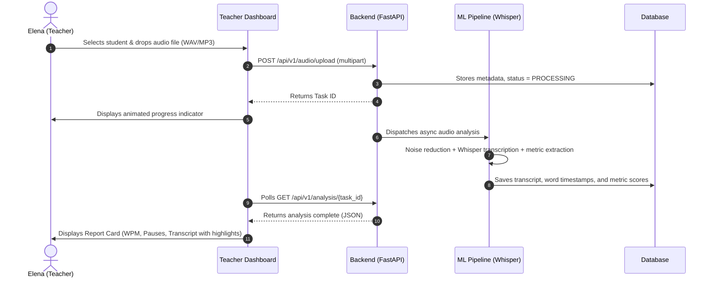

# Product Requirements Document (PRD)

# 🎙️ Read Analyzer: Automated Speech & Language Development Monitoring

* **Product:** Read Analyzer
* **Document Version:** 1.0.0
* **Date:** October 2026
* **Status:** Draft / Active
* **Product Owner:** Artsiom Beniash
* **Engineering Team:** Alpha-276 (Team Alpha)
* **Jira Board:** [RA Board](https://uvb.atlassian.net/jira/software/projects/RA/boards/2)
* **Repository:** [Alpha-276/read-analyzer](https://github.com/Alpha-276/read-analyzer)

---

## 1. Executive Summary & Vision

### 1.1 Vision Statement
To empower school teachers and educational therapists with automated, objective, AI-driven insights into children's speech development, enabling early detection of speech impediments, stuttering, and language delay through non-intrusive voice analysis.

### 1.2 Core Value Proposition
* **Automated Screening:** Reduces speech screening time from hours of manual listening to seconds per audio sample.
* **Objective Metrics:** Replaces subjective impression with quantifiable indicators: speech rate (WPM), hesitation pause lengths, syllable repetitions, and lexical diversity.
* **Longitudinal Progress:** Tracks developmental progress over months and school years using longitudinal profiling.
* **Extensible Platform:** Modular architecture designed to incorporate additional developmental and cognitive diagnostic modules in future iterations.

---

## 2. Problem Statement & Target Audience

### 2.1 The Problem
In modern school environments:
1. **High Student-to-Teacher Ratio:** A typical primary school teacher manages 20–30 students and lacks time to listen attentively to individual speech patterns.
2. **Delayed Intervention:** Speech therapists (логопеды) often assess students only after developmental gaps or severe stuttering become entrenched.
3. **Lack of Objective Tracking:** Progress tracking across school quarters relies on subjective notes rather than empirical acoustic metrics.

### 2.2 Target Personas

| Persona | Role | Primary Goal | Key Pain Point |
| :--- | :--- | :--- | :--- |
| **Persona 1: Primary School Teacher (Elena)** | Classroom Teacher (grades 1–4) | Quickly identify which students need attention without getting overwhelmed by technical jargon. | Has 25 students; cannot manually transcribe or measure reading fluency. |
| **Persona 2: Speech & Language Pathologist (Dr. Anna)** | Certified School Speech Therapist | Access precise acoustic measurements (pause durations, repetition markers) and export formal clinical reports. | Lacks quantifiable data to demonstrate progress to parents and educational boards. |
| **Persona 3: School Administration / Parents** | Stakeholders & Guardians | Understand clear, actionable progress summaries and recommendations. | Confused by raw medical or acoustic terminology. |

---

## 3. Product Principles

1. **Simplicity Over Complexity:** Traffic-light visual indicators (Normal / Moderate Attention / Priority Intervention) for general teachers; deeper clinical metrics on demand.
2. **Child Data Privacy First:** Strict adherence to student privacy. Raw audio never leaves secure storage without authorization; models operate with anonymized identifiers.
3. **No Fluff / High Signal:** Focus strictly on proven speech indicators (tempo, silence duration, repetition frequency, vocabulary richness) rather than speculative diagnostics.
4. **Resilience to Classroom Audio:** Preprocessing pipelines must handle noisy school background environments and low-fidelity microphone recordings.

---

## 4. Key Speech Metrics & Diagnostic Definitions

| Metric | Measurement Unit | Target / Normal Range (Ages 7–10) | Flag Criteria (Anomaly) |
| :--- | :--- | :--- | :--- |
| **Speech Rate (Tempo)** | Words Per Minute (WPM) | 90 – 130 WPM (reading/recitation) | < 75 WPM (severe hesitation) or > 160 WPM (tachylalia) |
| **Abnormal Pause Duration** | Seconds | Natural sentence pause: 0.4 – 1.0 s | Pauses > 2.0 s during continuous speech |
| **Pause Frequency** | Pauses per 100 words | 8 – 15 pauses | > 22 pauses per 100 words |
| **Repetitions (Stutter Marker)** | Count per minute | < 1 repetition | ≥ 3 immediate syllable/word repetitions per minute |
| **Lexical Diversity (TTR)** | Type-Token Ratio | 0.50 – 0.75 | < 0.35 (repetitive vocabulary / vocabulary poverty) |
| **Filler Word Ratio** | Percentage of total words | < 3% | > 8% (parasite words, prolonged hesitations) |

---

## 5. User Journeys & Core Workflows

### 5.1 Journey 1: Teacher Uploads and Reviews a Reading Sample


### 5.2 Journey 2: Speech Therapist Reviews Longitudinal Progress
1. Therapist opens student profile (`/students/{id}`).
2. Views trend charts over the past 2 years (WPM curve, stuttering incidents curve).
3. Compares recording from October 2024 against October 2026.
4. Clicks "Export Official PDF Summary" for parent-teacher conference.

---

## 6. Functional Requirements

### 6.1 Audio Ingestion & Preprocessing
* **FR-1.1:** System shall accept audio files in `.wav`, `.mp3`, `.m4a`, and `.ogg` formats up to 50 MB.
* **FR-1.2:** Audio pipeline shall automatically normalize sample rate to 16 kHz mono.
* **FR-1.3:** Audio pipeline shall apply ambient noise reduction to filter classroom background hum.
* **FR-1.4:** System shall validate audio duration (minimum 5 seconds, maximum 10 minutes).

### 6.2 Speech-to-Text & Metric Extraction (ML Engine)
* **FR-2.1:** System shall transcribe children's speech using pre-trained ASR models (OpenAI Whisper).
* **FR-2.2:** Engine shall output word-level timestamps (`start_time`, `end_time`, `word`).
* **FR-2.3:** Engine shall compute pause durations between consecutive words.
* **FR-2.4:** Engine shall detect immediate word/syllable repetitions (e.g., "ка-ка-карта", "я я я пошел").
* **FR-2.5:** Engine shall calculate overall Speech Rate (WPM) excluding non-speech silences.
* **FR-2.6:** Engine shall compute Type-Token Ratio (TTR) to assess vocabulary richness.

### 6.3 Teacher Web Interface (Frontend)
* **FR-3.1:** Intuitive Drag-and-Drop file uploader with immediate file size and format validation.
* **FR-3.2:** Progress status bar during analysis (Uploading -> Processing -> Ready).
* **FR-3.3:** Metric Summary Cards: Speech Rate, Long Pause Count, Repetition Count, Overall Status.
* **FR-3.4:** Interactive Audio Player: Play/pause, scrubbing bar, volume control.
* **FR-3.5:** Synced Interactive Transcript: Clicking any word in the transcript seeks audio playback to that exact second.
* **FR-3.6:** Issue Highlighting: Flagged pauses (> 2.0s) and repetitions highlighted in warning colors (amber/red).
* **FR-3.7:** Student Directory: Searchable list of students with last recorded date and status badge.
* **FR-3.8:** Longitudinal Trend Charts: Visualization of metric trajectories over multiple recordings.

### 6.4 Reporting & Export
* **FR-4.1:** One-click PDF report generation containing student summary, key metrics, flagged anomalies, and teacher notes.

---

## 7. Dataset & Supercomputer Strategy (500 Children / 2 Years)

### 7.1 Dataset Role
* The dataset serves as the benchmark baseline to calibrate normal speech parameters for children aged 7–12.
* Provides empirical validation for model accuracy (Word Error Rate on children's voices vs. adult voices).

### 7.2 Supercomputer (HPC) Utilization
* **Batch Preprocessing:** Bulk conversion, normalization, and noise reduction of historical recordings.
* **Benchmark Inference:** High-throughput batch inference across thousands of audio files to establish developmental baseline curves.
* **Fine-Tuning (Optional / Stretch Goal):** Low-Rank Adaptation (LoRA) or acoustic model fine-tuning if off-the-shelf Whisper yields WER > 25% on children's speech.

---

## 8. Non-Functional Requirements

### 8.1 Performance & Scalability
* **Inference Latency:** A 1-minute audio recording must be processed within ≤ 15 seconds on CPU / ≤ 4 seconds on GPU.
* **API Responsiveness:** All standard metadata queries (non-ML) must respond within ≤ 200 ms.
* **Asynchronous Execution:** Heavy ML inference must never block API HTTP worker threads.

### 8.2 Security & Data Privacy
* Audio files must be stored in secure local/cloud object storage with no public URL access.
* Database records must not expose raw student PII in public logs.
* No raw student audio shall be transmitted to unauthenticated third-party external APIs without encryption.

### 8.3 Reliability
* Graceful handling of corrupted audio files with descriptive user error messages.
* Automatic retry mechanism for transient processing worker failures.

---

## 9. Release Phasing & MVP Scope

```text
+---------------------------------------------------------------------------------+
| Phase 1: MVP (Sprint 1 - 2)                                                     |
| - Audio upload (.wav, .mp3)                                                     |
| - Whisper transcription with word timestamps                                   |
| - Basic metrics: WPM, Pause count, Duration                                     |
| - Synced audio playback with transcript                                         |
+---------------------------------------------------------------------------------+
                                      |
                                      v
+---------------------------------------------------------------------------------+
| Phase 2: Complete School Solution (Sprint 3 - 4)                               |
| - Stuttering & repetition detection algorithms                                  |
| - Student profiles & longitudinal progress charts (2-year dataset analysis)     |
| - Supercomputer batch processing results integration                            |
| - Printable PDF diagnostic reports                                              |
+---------------------------------------------------------------------------------+
                                      |
                                      v
+---------------------------------------------------------------------------------+
| Phase 3: Future Extensibility (Sprint 5 & Beyond)                              |
| - Acoustic phoneme/dyslalia detection (lisp, pronunciation defects)             |
| - Semantic/cognitive comprehension analysis                                     |
| - Multi-school organization management                                          |
+---------------------------------------------------------------------------------+
```

---

## 10. Success Criteria & Evaluation

1. **Functional Completeness:** A teacher can upload a child's recording and receive a highlighted transcript and metrics report in under 20 seconds.
2. **Clinical Utility:** School speech therapist can identify verified speech anomalies (stuttering, long hesitation) matching manual therapist evaluations.
3. **Delivery:** Monorepo clean build, automated test coverage > 75% on core modules, zero-error CI run on GitHub Actions.
